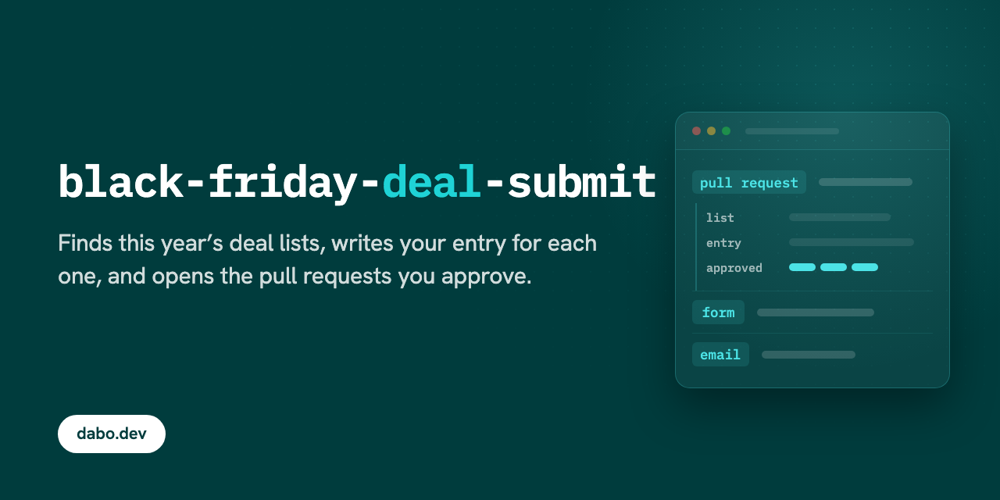

# black-friday-deal-submit

A Claude Code skill that submits your sale to the deal lists where it fits. It finds
this year's lists, reads each one's rules on the day, writes your entry in that list's
format and opens the pull request only after you approve it. Built for Black Friday;
it works the same for any sale.

- **Lists are data.** [`listings/`](listings/) holds one record per list with its rules
  and the date it was last checked. The skill re-reads every live one before it writes.
- **Nothing is published, submitted, posted or pushed without your yes.** Reading and
  searching public pages and repositories happens before that, and the search terms
  include your product's name.
- **Facts only.** Every entry is built from your intake file. No invented claims, no
  rounded prices, no "Mac" when the app has no Mac build.
- **Portable.** A `SKILL.md` plus reference files in the open Agent Skills format, no
  code to install.

## Install

Paste this into Claude Code inside the project that holds your product:

```
Clone https://github.com/dabodamjan/black-friday-deal-submit to a permanent folder outside this project, link its skills/black-friday-deal-submit folder into ~/.claude/skills, and submit my sale to the deal lists where it fits.
```

You need `git` and the GitHub CLI (`gh`) signed in as you.

Or do it by hand:

```bash
cd ~   # or any permanent folder outside your product's repository
git clone https://github.com/dabodamjan/black-friday-deal-submit.git
mkdir -p ~/.claude/skills
ln -s "$PWD/black-friday-deal-submit/skills/black-friday-deal-submit" ~/.claude/skills/black-friday-deal-submit
```

Keep the clone where it is: the link points into it, and the skill reads `listings/`
from it. For one project only, link into that project's `.claude/skills/` instead.
Then run `/black-friday-deal-submit` in a Claude Code session inside your project. A
copied skill folder without the rest of the repository works too: the skill fetches
the current records from this repository, and says so if that fetch fails.

Pull requests open from a fork under your name, created only after you approve the
destination. Python 3 runs the optional listings check.

## What a run looks like

The fit table, before anything is prepared (an excerpt from the November 2026 run for
a QR code app for iPhone, iPad and Mac):

```
| List                                | Fits            | Route                     | Cost      |
|-------------------------------------|-----------------|---------------------------|-----------|
| black-friday-deals (dqhieu)         | yes             | pull request, one row     | free      |
| IndieMarkdowns                      | yes             | form (pre-filled email)   | free      |
| Apps.Deals                          | yes             | form                      | free      |
| awesome-black-friday-for-developers | maybe           | pull request, one product | free      |
| Black Friday Times                  | paid, not taken | form                      | paid only |
| Black Friday App Deals (niceapp.it) | dead            |                           |           |
```

The full table also has a Why column and a Deadline column. A list whose bot or
curator checks the live price shows `from <start date>` as its deadline, and its entry
waits for that day.

One prepared entry, in the list's own row format, read from its rules file that day:

```
|🤑|[QRGenie](https://qrgenie.app/black-friday)| QR code generator for iPhone, iPad and Mac. | **50% OFF** lifetime: $9.99, down from $19.99, no code needed (Nov 18 – Dec 4, 2026)|
```

Before a pull request opens you approve three things, one at a time: the destination,
the full diff as it will be pushed, and the pull request title and body. The branch is
pushed and the pull request opened only after three yeses, and only when the entry
passes the list's check, or you have chosen not to run it and been told. A "no" at any
approval leaves the entry prepared and nothing pushed. The prompts are in
[`docs/walkthrough.md`](docs/walkthrough.md), a paper walkthrough with a made-up
product. The finished entries from that run, as merged on the lists, are in
[`examples/`](examples/).

## How it runs

1. **Intake, once.** Product, platforms, one-line description, offer, code or no code,
   dates, the sale page that shows the price, where the price appears. Saved to
   `deal-submissions/deal.md` in your project.
2. **Find this year's lists.** The listings folder, recommended records first, then
   GitHub search, web search and the "N places to list your deal" posts. Hits that are
   plainly not deal lists are dropped on their description and counted; every other
   candidate is opened before it counts.
3. **Read each list's rules today.** Accepts, cost, route, format, deadline, what gets
   an entry closed. Last year's record is a hint, not a fact.
4. **Fit table.** You confirm the set.
5. **Entries in each list's own format**, from the intake facts only.
6. **Submit.** Pull requests after three approvals, when the entry passes the list's
   check or you have chosen not to run it and been told; entries for lists that
   check the live price wait until the sale has started; form and email text handed
   over. Licence and agreement boxes in a pull request template stay unticked; you
   tick them on the pull request page.
7. **Track.** `deal-submissions/status.md`: list, what was sent, date, link, state.
   A later run checks the open pull requests and submitted listings first, updates
   their states and tells you what changed.
8. **Rejections and comments** stop the work on that list and come to you verbatim.
   A rejected entry is not resubmitted unless the list's live rules, read again, no
   longer contain the rule that caused the rejection. A "star this" request is shown
   to you, never followed.

## Limits

- **The listings are a November 2026 snapshot.** Lists change owners, names, formats
  and rules every year. Every record carries its `checked_on` date, and the skill
  re-reads the live page before preparing anything, but a list that moved or died
  since then costs a visit to find out. Recommended means a free entry from an
  outsider got in during November 2026. It says nothing about how many visitors a
  list brings, and the skill does not track visits or sales per list.
- **It opens pull requests on other people's repositories.** You read and approve
  every destination, every diff and every pull request text, and maintainers decide
  what they merge. A reply to a maintainer's comment is posted only after you approve
  its text. It does not fill web forms and does not send email: you get the text per
  field and the email ready to paste. It never creates accounts, signs in, accepts
  terms or pays for a placement.
- **It cannot read what fetchers cannot read.** Pages that need JavaScript, forms
  behind a sign-in, Reddit, and some social search endpoints come back as "unread",
  and the skill says so instead of guessing.
- **A list's own check script does not run unless you say so.** The skill checks
  your entry against the list's written rules by reading them. If you want the
  list's validator run as well, it shows you the script first and says plainly what
  the command does: it removes environment variables, tokens among them, and
  points `HOME` at an empty folder. It does not stop the script from reading files
  on your disk or using the network. Claude Code asks for its own approval of that
  command too.

## The listings folder

[The post](https://dabo.dev/where-to-submit-black-friday-deal) covers the 20 places I
submitted to. This repository holds 65 records checked in November 2026; 15 are marked
recommended because a free entry from someone other than the maintainer got in that
season.

Each recommended record says in a few words what kind of product it takes (Mac apps,
iPhone apps, developer tools, software of any kind), and the generated
[`INDEX.md`](listings/INDEX.md) opens with them. The other 50 records are live lists
where no free entry has been seen to get in yet, lists behind a sign-in that were not
tried, paid-only lists, dead ones, copies of other lists, and pages that could not be
read; they are kept so you do not visit them twice.

To add a list, copy `_template.json`, fill it from the list's own page, run
`python3 scripts/check-listings.py`, and open a pull request. The schema, the
recommended test and the rules for what a record may contain (public rules only, no
correspondence, no opinions about maintainers) are in
[`listings/README.md`](listings/README.md).

## Use with other agents

The skill is a `SKILL.md` plus reference files in the open
[Agent Skills format](https://agentskills.io). Copy
`skills/black-friday-deal-submit/` into whatever directory your agent reads skills
from. It needs a fetch tool for the live reads and a shell with `git` and `gh` for the
pull requests; the `allowed-tools` frontmatter field is spec-experimental, so support
may vary. Agents without native skill support can be pointed at the `SKILL.md` and
asked to follow it.

## Prior art

Several lists ship their own helpers for their own list: BoltAI publishes an agent
prompt and a short form for its Mac and iOS list, the Black-Friday-Deals list by mRs-
has a form that opens the pull request for you, Indie Goodies takes an issue form, and
a few lists ship a validator you run before the pull request. Each covers one list.
Among the lists I submitted to in November 2026 I found nothing that runs the whole
round across lists, keeps the list rules as data, and holds the pull request until a
person has approved it. If you know of one, open an issue and I will link it here.

## Who made this

I am [Damjan Dabo](https://dabo.dev), an indie iOS developer in Croatia. I have
been shipping my own apps on the App Store since 2022 ([Itemlist](https://getitemlist.app),
[QRGenie](https://qrgenie.app), [BarcodeCraft](https://barcodecraft.com)); this
skill is the process I ran with Claude Code for their Black Friday 2026 sale. Every
place I submitted to, with its rule, is in
[20 Free Places to Submit Black Friday App Deals](https://dabo.dev/where-to-submit-black-friday-deal).
I write about building iOS apps and working with AI tooling at
[dabo.dev](https://dabo.dev), and I am on
[LinkedIn](https://www.linkedin.com/in/damjan-dabo/) and
[X](https://x.com/DamjanDabo).

Found a list that is missing, moved or dead? Issues and pull requests are welcome;
see [CONTRIBUTING.md](CONTRIBUTING.md). If it got your deal onto a list, a star helps
others find it.

## License

MIT. See [LICENSE](LICENSE).
